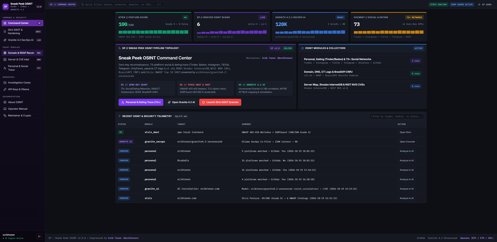
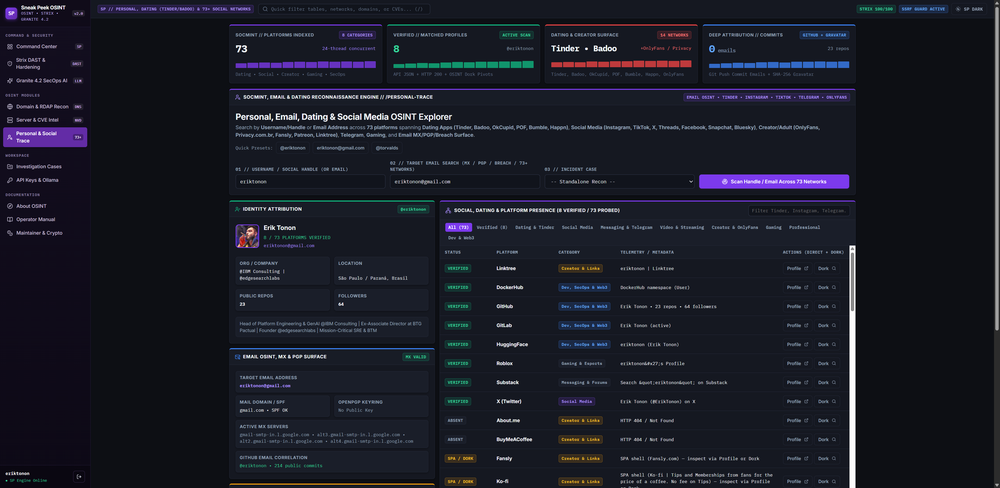
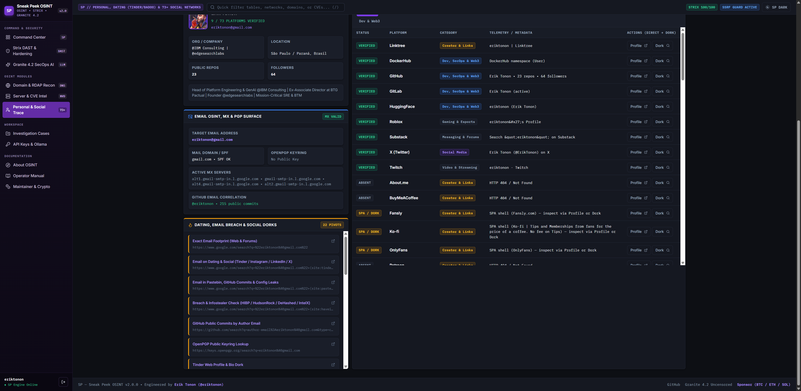
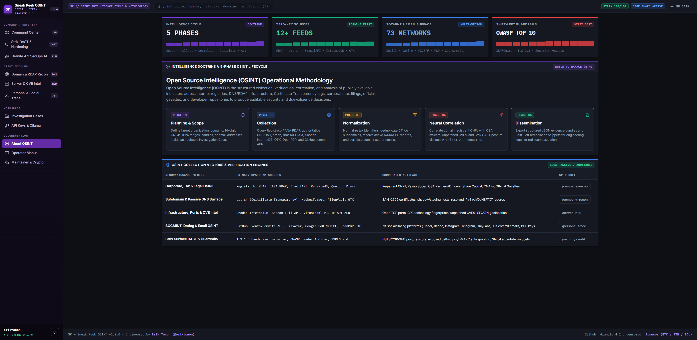

# SP — Sneak Peek OSINT v2.0 (2026 Edition)

[](https://www.python.org/)
[](https://flask.palletsprojects.com/)
[](controller/Facebook.py)
[](https://ollama.com/eriktonon/granite4.2-uncensored)
[](SECURITY.md)
[-003B57?logo=sqlite&logoColor=white)](https://www.sqlite.org/)
[](LICENSE)
[](https://github.com/sponsors/eriktonon)

```text
             ██████  ██▓███   ▒█████  
           ▒██    ▒ ▓██░  ██▒▒██▒  ██▒
           ░ ▓██▄   ▓██░ ██▓▒▒██░  ██▒
             ▒   ██▒▒██▄█▓▒ ▒▒██   ██░
           ▒██████▒▒▒██▒ ░  ░░ ████▓▒░
           ▒ ▒▓▒ ▒ ░▒▓▒░ ░  ░░ ▒░▒░▒░ 
           ░ ░▒  ░ ░░▒ ░       ░ ▒ ▒░ 
           ░  ░  ░  ░░       ░ ░ ░ ▒  
                 ░               ░ ░

     S n e a k   P e e k   O S I N T   v 2 . 0
     Lead Architect & Maintainer: Erik Tonon (@eriktonon)
```

**SP — Sneak Peek OSINT** is an open-source intelligence (OSINT) reconnaissance and **Offensive-Defensive AppSec platform** engineered for **Security Researchers, Penetration Testers, Threat Intelligence Analysts, Compliance & Legal Teams, HR Professionals, and Investigative Journalists**.

In **v2.0 (2026 Edition)**, SP has been rebuilt from the ground up with a high-density **SecOps & SIEM Observability interface** (`SP Dark` / `SP Light`), **73+ Social, Dating & Creator Network enumeration**, **Direct Email OSINT**, **PE-AGENTS-IBM Shift-Left Security**, the **Strix DAST & Prevention Engine** (`/pentest-strix`), and local neural OSINT correlation powered by **[`eriktonon/granite4.2-uncensored`](https://ollama.com/eriktonon/granite4.2-uncensored)** on **Ollama**.

---

## 📸 Interface Preview (`SP Dark` SIEM UI)

| Command Center (`/dashboard`) | Personal, Dating & Direct Email OSINT (`/personal-trace`) |
| :---: | :---: |
|  |  |

| Dating, Email Breach & Social Dorks (`/personal-trace`) | 5-Phase OSINT Methodology (`/about-osint`) |
| :---: | :---: |
|  |  |

---

## 🕵️ Personal, Dating, Social & Direct Email OSINT (`/personal-trace`)

The SOCMINT & Email engine ([`controller/Facebook.py`](controller/Facebook.py)) runs **24-thread concurrent reconnaissance** when given a **Username/Handle**, an **Email Address**, or both:

- **Direct Email Search (`_email_osint_recon`)**:
  - **DNS MX & SPF Verification**: Queries Google DNS-over-HTTPS (`dns.google/resolve`) for active mail exchangers and `v=spf1` policies.
  - **GitHub Email-to-Account & Commit Correlation**: Queries `api.github.com/search/commits?q=author-email:<email>` and `api.github.com/search/users` to uncover the exact GitHub username and public commit count associated with an email address.
  - **OpenPGP Public Keyring Lookup**: Checks `keys.openpgp.org` HKP API for registered PGP keys.
  - **Gravatar SHA-256 & MD5 Resolution**: Extracts avatar, display name, and linked profile metadata.
- **73+ Platforms Across 8 Categories**:
  - **Dating & Apps**: Tinder, Badoo, OkCupid, Plenty of Fish (POF), Bumble, Happn, Hinge, Grindr, Taimi.
  - **Social Media**: Instagram, TikTok, X (Twitter), Threads, Facebook, Bluesky, Mastodon, Snapchat, Pinterest, Tumblr, VK, Weibo, Flickr.
  - **Creator & Adult**: OnlyFans, Privacy.com.br, Fansly, Patreon, Ko-fi, BuyMeACoffee, Linktree, Carrd, Beacons.ai, Gumroad, About.me.
  - **Messaging & Forums**: Telegram (`t.me`), WhatsApp (`wa.me`), Discord, Signal, Keybase, Reddit, Quora, HackerNews, Substack, Medium, Dev.to, Hashnode.
  - **Video, Audio & Streaming**: YouTube, Twitch, Kick, Vimeo, DailyMotion, Rumble, SoundCloud, Spotify, Last.fm, Mixcloud, Letterboxd, Goodreads.
  - **Gaming & Esports**: Steam, Chess.com, Lichess, Roblox, Xbox Live, Speedrun.com, itch.io, Strava.
  - **Dev, SecOps & Web3**: GitHub, GitLab, Bitbucket, DockerHub, PyPI, NPM, Crates.io (Rust), HuggingFace, Kaggle, Replit, CodePen, LeetCode, HackerRank, TryHackMe, HackerOne, OpenSea.
  - **Professional & Freelance**: LinkedIn, SlideShare, Behance, Dribbble, Gravatar, 99Freelas, Workana, Fiverr, Upwork.
- **22+ Dating, Email Breach & Infostealer Dork Pivots**: One-click search pivots for HaveIBeenPwned, HudsonRock Cavalier Infostealer logs, DeHashed, IntelX, Pastebin/GitHub config leaks, Tinder/Bumble/Badoo bios, and Brazilian CPF/Processos Judiciais (Jusbrasil / Diários Oficiais).

---

## 🧠 Native SecOps AI Integration: [`eriktonon/granite4.2-uncensored`](https://ollama.com/eriktonon/granite4.2-uncensored)

SP v2.0 includes a dedicated **Granite 4.2 Uncensored SecOps Co-Pilot** (`/granite-ai` — [`controller/OllamaGranite.py`](controller/OllamaGranite.py)) built around Erik Tonon's abliterated & SecOps-tuned LLM:

- **Model Image**: [`eriktonon/granite4.2-uncensored`](https://ollama.com/eriktonon/granite4.2-uncensored) (`IBM Granite 4.2 8B`, 40 layers, 128K context window, 5.7 GB).
- **Orthogonal Refusal Direction Abliteration**: Refusal directions neutralized across 26 intermediate transformer layers (layers 10–35).
- **SecOps / DeepEvil LoRA**: Fine-tuned for OSINT multi-source correlation, attack surface modeling, reverse engineering, exploit PoC analysis, and Shift-Left remediation without synthetic refusal lectures.

```bash
# Pull & run the official SecOps model on your local Ollama instance:
ollama pull eriktonon/granite4.2-uncensored
ollama run eriktonon/granite4.2-uncensored
```

---

## 🛡️ Architecture & Module Overview (v1.0 vs v2.0)

| Module / Layer | Legacy v1.0 (2018) | Modernized v2.0 (2026 — Erik Tonon) |
| :--- | :--- | :--- |
| **Runtime & Web Stack** | Python 3.5 + Flask 0.12 + committed `vspo/` venv | **Python 3.10–3.12 + Flask 3.x + Gunicorn + Non-Root Docker Compose** |
| **UI & URL Routing** | AdminLTE Bootstrap 3 + camelCase URLs | **SP Dark/Light SIEM UI + clean lowercase/kebab-case routes (`/personal-trace`, `/company-recon`, `/server-intel`, `/security-audit`, `/granite-ai`, `/api-keys`, `/about-osint`)** |
| **SecOps LLM Engine** | *None* | **Ollama + [`eriktonon/granite4.2-uncensored`](https://ollama.com/eriktonon/granite4.2-uncensored) (8B Abliterated + SecOps LoRA, 128K Context)** |
| **Database Engine** | Manual MySQL server + raw SQL string concatenation | **Zero-Config SQLite WAL (`data/spo.db`) + 100% Parameterized SQL** |
| **Authentication & AuthZ** | Static `"potato"` SHA-256 salt + no rate limiting | **Salted `PBKDF2-HMAC-SHA256` + Constant-Time Digest + Sliding-Window Brute-Force Shield + CSRF Tokens** |
| **Strix DAST & Prevention (`/security-audit`)** | *None* | **Built-in Black-Box Surface DAST Auditor (OWASP Top 10 headers, TLS 1.3 cipher inspection, `.env`/`.git` exposure probes, DNS SPF/DMARC anti-spoofing, CVSS v3.1 scoring & Shift-Left Autofix snippets)** |
| **SSRF & Network Guardrail** | Unvalidated outbound requests | **`SSRFGuard` blocking loopback, RFC1918 private networks, Cloud Metadata (`169.254.169.254`), DNS Rebinding, and gateway `192.168.3.1`** |
| **Domain & Corporate OSINT (`/company-recon`)** | Legacy `python-whois` + defunct `compras.dados.gov.br` | **Registro.br & IANA RDAP + Google DoH + `crt.sh` / HackerTarget / OTX Subdomains + BrasilAPI & ReceitaWS QSA Partners + Querido Diário** |
| **Server & CVE Intel (`/server-intel`)** | Required paid Shodan key + hardcoded VT v2 key | **Zero-Key Shodan InternetDB (open ports, CPEs, CVEs) + IP Geolocation/ASN + VirusTotal API v3 + AlienVault OTX Threat Pulses** |
| **Personal, Dating & Email Recon (`/personal-trace`)** | Broken 2017 Facebook HTML scraper | **Concurrent 73-platform social/dating recon + Direct Email OSINT (DNS MX/SPF, OpenPGP, GitHub commit author-email correlation, Gravatar) + 22+ Dorks** |

---

## 🔒 Preventive Tactics & Strix Security Engine (`/security-audit`)

SP v2.0 implements both **internal Shift-Left self-protection** and **external Offensive-Defensive DAST auditing** in [`controller/StrixSecurity.py`](controller/StrixSecurity.py):

- **`SSRFGuard` (OWASP A10:2021)**: Validates every target domain/IP before executing outbound OSINT or DAST requests. Blocks loopback (`127.0.0.0/8`, `::1`), RFC1918 internal networks (`10.0.0.0/8`, `172.16.0.0/12`, `192.168.0.0/16`), link-local Cloud Metadata (`169.254.169.254`), DNS Rebinding, and enforces a strict guardrail on `192.168.3.1`.
- **`LoginRateLimiter` (OWASP A04 / A07:2021)**: Sliding-window rate limiter per client IP that locks out credential-stuffing or brute-force attempts (`HTTP 429`).
- **`CSRFShield` & `PasswdHash` (OWASP A01 / A02:2021)**: Synchronizer token validation and password verification using `hmac.compare_digest` with salted `PBKDF2-HMAC-SHA256`.
- **`SecurityHeadersMiddleware` (OWASP A05:2021)**: Injects `Content-Security-Policy` (CSP), `Strict-Transport-Security` (HSTS), `X-Frame-Options: DENY`, `X-Content-Type-Options: nosniff`, `Referrer-Policy`, `Permissions-Policy`, and `Cross-Origin-Opener-Policy`.
- **`SecurityAuditLogger` (OWASP A09:2021)**: Structured security telemetry visible directly inside `/security-audit`.

---

## 🚀 Quick Start

### Option 1: Docker Compose (Recommended)

```bash
git clone https://github.com/eriktonon/SPO-Sneak-Peek-OSINT.git
cd SPO-Sneak-Peek-OSINT
docker compose up --build -d
```

Open **`http://localhost:1337`** in your browser. On first access, SP will prompt you to register your local operator account.

### Option 2: Local Python Environment (Windows / Linux / macOS)

```bash
git clone https://github.com/eriktonon/SPO-Sneak-Peek-OSINT.git
cd SPO-Sneak-Peek-OSINT
python -m venv .venv

# Windows PowerShell:
.\.venv\Scripts\Activate.ps1
# Linux / macOS:
# source .venv/bin/activate

pip install -r requirements.txt
python main.py
```

### Running the Automated Verification Suite

```bash
python -m pytest -v
```

---

## 👨‍💻 Author & Maintainer

**Erik Tonon** ([@eriktonon](https://github.com/eriktonon))  
*Head of Platform Engineering & GenAI @ IBM Consulting | Ex-Associate Director @ BTG Pactual | Founder @ EdgeSearch Labs*

- 🌐 **Website & Portfolio**: [https://eriktonon.com](https://eriktonon.com)
- 🛡️ **BTM Readiness & AppSec Score**: [https://score.eriktonon.com](https://score.eriktonon.com)
- 🧠 **Ollama Hub (Granite 4.2 Uncensored)**: [https://ollama.com/eriktonon/granite4.2-uncensored](https://ollama.com/eriktonon/granite4.2-uncensored)
- 💼 **LinkedIn**: [https://www.linkedin.com/in/eriktonon/](https://www.linkedin.com/in/eriktonon/)
- 💻 **GitHub**: [https://github.com/eriktonon](https://github.com/eriktonon)
- 💖 **GitHub Sponsors**: [https://github.com/sponsors/eriktonon](https://github.com/sponsors/eriktonon)

---

## 🪙 Crypto Donations & Support

**SP — Sneak Peek OSINT** is 100% free and open-source software. If this project supports your security research, OSINT investigations, or Red/Blue Team operations, you can contribute directly via cryptocurrency:

| Network / Asset | Official Wallet Address (`@eriktonon`) |
| :--- | :--- |
| **Bitcoin (BTC — Native SegWit)** | `bc1q0hr95ay33rtazfepg64yddf52q3yqh7ud83cza` |
| **Ethereum (ETH / ERC-20 / Base / Polygon)** | `0xE69FCE4Fa35CF3bd98F496337b1eA223270b2c92` |
| **Solana (SOL / SPL)** | `3E8L1Hdqe7Xk6GCrzHbtY5sReAfLFc9CdwgZxP7qaoHq` |

---

## ⚖️ Legal Disclaimer & License

This software is provided strictly for **authorized security auditing, educational research, corporate due diligence, and lawful Open-Source Intelligence (OSINT)** gathering using publicly accessible data sources. Users are solely responsible for complying with applicable local laws (including LGPD/GDPR) and authorization boundaries.

Licensed under the **GNU General Public License v2.0 (GPLv2)** — see [LICENSE](LICENSE) for details.
